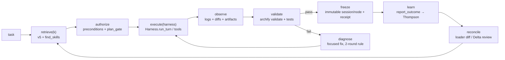

# Master Simulation: Research → Integrate Archify + OpenResearch into NEXUS

**Date:** 2026-09-14 · **Scope:** full-process simulation of the integration, grounded in this repo's real files.
**Honesty note:** GitNexus MCP (`query`/`context`/`impact`/`trace`) is stale here (index 2026-08-18, KuzuDB v43 skew — see `docs/assistant_local_harness_design.md` §0). Stage 0 blocks are **simulated queries reconstructed from direct reads** (`read`/`grep`/`repo_map` with file:line anchors). Re-run each block verbatim once the graph is fresh; HIGH/CRITICAL rows still gate on live `impact()`.
**Parent docs:** `docs/nexus_cordis_tencent_evaluation.md` (research) · `docs/assistant_local_harness_design.md` (HLD/LLD M1–M20) · `docs/local_harness/README.md` (20 per-file builds) · `docs/nexus_docs_code_graph.md` (21 loops) · `docs/openresearch_adaptation.md` (A1–A10) · `docs/archify_adaptation.md` (B1–B6).
**System-design roots already in repo:** `designs/NEXUS_SYSTEM_DESIGN_PLAN_v1.md` (irreducible loop + RC1–RC7) · `docs/FILE_EXECUTION_MAP.md` (file-card protocol) · `docs/process_topology.md` (split ownership) · `docs/execution_plane_contract.md` (session contract v1).

---

## Stage 0 — Research simulation (GitNexus query blocks per area)

Run order follows `gitnexus-exploring`: `context` overview → `query` concept → `context` symbol → `process` trace. Expected outputs below are what the reads already prove; live runs must confirm.

### Q0. Sessions & lifecycle
```
query({search_query: "ephemeral tool session lifecycle"})
→ Processes: open_session (execution_plane.py:166), start_session (tool_session_broker.py:109),
   report_session (execution_plane.py:254), end_session (tool_session_broker.py:169)
context({name: "ToolSessionBroker"})
→ In: execution_plane.open_session, nexus-mcp-enhanced.task_start · Out: _route, _select_tools,
   _build_context_block, _persist_session, ide_manager.link · Max tools 8, harness tools ≤16
impact({target: "start_session", direction: "upstream"}) → HIGH (execution_plane + MCP callers)
```
**Finding:** broker owns `_active` + SQLite persist + IDE link + learning record; **no inverse tracking** (gap → M3/M7; OpenResearch freeze-rule target → A6).

### Q1. Routing v5 + fusion
```
query({search_query: "unified route intent cluster rerank fusion"})
→ unified_route_v5 (router_v2/v5.py:408): L1 intent → short-circuit → L2 top-2 → L3 convex → L4 autocut
context({name: "v5_get_weights"}) → fusion.py:322, NEXUS_V5_W_* overrides + renormalize
context({name: "v5_fusion_scores"}) → fusion.py:396, 4-term fixed (0.45/0.25/0.20/0.10)
impact({target: "unified_route_v5", direction: "upstream"}) → HIGH (cutover + execution_plane + MCP)
```
**Finding:** production ranker, read-only vs Thompson; fixed weights + fixed gate (gaps → M10 shared-prior/recycle, M11 adaptive gate/Chimera; Tencent Large/TurboS/MT grounding).

### Q2. Preconditions & resilience
```
context({name: "StateGates"}) → precondition.py:65-114, check()/snapshot(), GLOBAL_GATES singleton
context({name: "CircuitBreaker"}) → resilience/circuit_breaker.py:111, CLOSED→OPEN→HALF_OPEN + Bulkhead + _RedisStateBackend (best-effort, NEXUS_CIRCUIT_REDIS=1)
trace({from: "route_task", to: "can_invoke"}) → router v4 pipeline step 4 gate position
```
**Finding:** boolean gates + global breaker keyspace (gaps → M9 subscribe/notify, M15 realms; OpenResearch plan_gate/watchdog → A4/A5).

### Q3. Cache & store
```
context({name: "L0Cache"}) → context_harness/cache.py:916 lines, L0 256/2k · L1 500/8k · L2 400/16k · L3 64/4k TTL300
query({search_query: "redis cache centroid embedding"}) → NOT LIVE: no redis dep; _RedisStateBackend only; redis_cache.py uncreated (remediation ARCH-3)
```
**Finding:** token-budgeted L0–L3 + `DB_PATH` home-hardcode bug (→ M12/M13; Tencent GQA/CLA analog).

### Q4. MCP/IDE surface & skills
```
context({name: "task_start"}) → nexus-mcp-enhanced.py:686-714 (broker + mcp_proxy payload)
query({search_query: "opencode connector harness bridge"}) → opencode-with-nexus.sh (44 lines) + harness_mcp_bridge.py (27 tools) + opencode_connector.py SOURCE MISSING (pyc-only)
query({search_query: "skill resource bundle find_skills"}) → resources table + bundles + .claude/skills/skill-builder/SKILL.md (packaging path for A9)
```
**Finding:** stdio-only split ownership (→ M5/M8/M16/M17; OpenResearch Harness-trait → A1; Archify DSH plugin → B5).

### Q5. Maps & review
```
query({search_query: "architecture map diagram review delta"}) → Mermaid-only (nexus_docs_code_graph.md) + code-review skill (no visual) + detect_changes (flows, no picture)
```
**Finding:** no validated visual layer (→ B1–B4; Archify toolchain proven: showcase 0/0, doctor all-ok).

---

## Stage 1 — System-design doc map (what governs what)

| Doc | Role in this integration |
|---|---|
| `designs/NEXUS_SYSTEM_DESIGN_PLAN_v1.md` | Root law: irreducible loop `task → retrieve(k) → authorize → execute(harness) → observe → learn → (better retrieve)`; RC1–RC7 must stay closed (our changes are additive-default-off, so they do) |
| `docs/FILE_EXECUTION_MAP.md` | Card protocol we imitate: file card = path + touch type + anchors + instructions + verify + deps; ledger order; manual verify (same GitNexus-unavailable note as ours) |
| `docs/assistant_local_harness_design.md` | HLD/LLD + M1–M20 table (the work-order source of truth) |
| `docs/local_harness/M*.md` (20) | Per-file pseudocode + tests (loop entry points) |
| `docs/openresearch_adaptation.md` | A1–A10 (harness trait, playbook, freeze policy, skills, telemetry) |
| `docs/archify_adaptation.md` | B1–B6 (maps, delta review, flow IRs, reach-vs-impact, plugin) |
| `docs/nexus_docs_code_graph.md` + `.json` | 21 loops + hubs + closure checklist (extended §Stage 4) |

---

## Stage 2 — Work orders per file (all-in-one table)

`[M]` = local-harness base (pseudocode in its M-doc) · `[A]` = OpenResearch adaptation · `[B]` = Archify adaptation. Status: ⬜ not started.

### A. CREATE — new files (11)

| # | File | Area worked | Instruction (pseudocode essence) | Verify |
|---|---|---|---|---|
| M1 | `server/local_harness/__init__.py` | package | re-export context/session/loader; no `server.*` top imports | import smoke |
| M2 | `server/local_harness/context.py` | coeffects | `NexusContext` + `CoeffectSpec` + `classify_transition` trichotomy; stdlib only | trichotomy units |
| M3 | `server/local_harness/session.py` | lifecycle | `effect/require/commit_providers/refresh/dispose` + inertial states + armed at-most-once + LIFO | chaos-100 zero-leak |
| M4 | `server/local_harness/loader.py` | reconcile | `EntryTree` keyed diff + per-field policy + backup/swap/rollback | insert<2s, delete-revert, rollback |
| M8 | `server/opencode_adapter.py` | IDE compat | `get_opencode_config/session_payload/report_mapping` (reuse execution_plane normalizer) + orphan-pyc audit | import + shell smoke |
| M12 | `server/cache/redis_cache.py` | L4 cache | `get_redis()` never-raises + `cached_skill_lookup` TTL/counters; default None | off-by-default, fallback |
| **A1** | `server/local_harness/harness.py` | multi-agent | `Harness` Protocol (`id/name/supports_chat/detect/run_turn/skill_shim`) + `registry()`; `WirePart` dataclass; OpenCode adapter moved here as `OpenCodeHarness` (M8 becomes thin re-export). Pseudocode: `class Harness(Protocol): …; REGISTRY=[OpenCodeHarness()] ; def get(ide)->Harness` | registry test, one-file-add test (stub harness, no dispatcher edit) |
| **A3** | `server/local_harness/playbook.py` | context contract | `render(name,id,state,artifacts)->str` durable playbook + `build_task_brief(session)->str`; broker uses `playbook + brief` as `context_block`. Pseudocode: `PLAYBOOK_TMPL.format(…); # task procedures stay in skills, never in playbook` | snapshot test of rendered block |
| **A6b** | `scripts/nexus_exp.py` | experiment runs | git-worktree sweep runner (OpenResearch `orx-git` model): `create --title → branch → run fixed command → collect summary → freeze`. Pseudocode: `worktree add ../runs/<id> -b exp/<slug>; run(cmd, cwd=worktree); archive(log,diff); mark frozen` | dry-run on eval set |
| M18 | `db/migrations/020_local_harness.sql` | ledger | `local_harness_sessions` + `local_harness_reconciles`, idempotent | double-apply clean |
| **A6c** | `db/migrations/021_experiments.sql` | exp tree | `experiments(id, parent_id, branch, run_command, frozen, result_json)` + `CHECK(frozen IN (0,1))`; no skill-data dup | idempotent + freeze-enforce trigger test |
| M19 | `tests/test_local_harness.py` | acceptance | 12 cases per M19-doc (trichotomy, LIFO, armed, realms, reconcile, chaos, …) | full file green offline |
| **B-skill** | `skills/nexus-router/SKILL.md` (+`nexus-eval`, `nexus-harness`) | cross-pollination | A9 packs for `orx skills add` (skill-builder format); each SKILL.md = when-to-use + 3 commands + receipt rule | `orx skills add` dry-run |
| **B-maps** | `docs/nexus-maps/nexus-runtime.architecture.json` (+ workflow/sequence/lifecycle) | visual proof | B1/B3: ≤12 nodes, showcase profile, primary path only; validate→deliver→HTML+receipt; frozen after pass | `validate` 0/0 + `deliver` exit 0 |

### B. MODIFY — existing files (10)

| # | File | Area worked | Instruction | Verify |
|---|---|---|---|---|
| M5 | `server/nexus-mcp-enhanced.py` | MCP surface | append 4 tools (open/report/reconcile/status), lazy imports, flag-off delegates to `task_start` | coexistence + round-trip |
| M6 | `server/execution_plane.py` | contract | `+local_session=None` kwarg only (opencode already allowlisted); playbook (A3) feeds `context_block` | opencode preserved + passthrough |
| M7 | `server/tool_session_broker.py` | sessions | `+ctx=None`; register persist-inverse + cluster coeffects; dispose after learn, before pop; never raise from disposer | identical-when-None + chaos |
| M9 | `server/precondition.py` | gates | `+subscribe/set_and_notify`, `check()` untouched; **A4**: `command_is_readonly()` heuristic → write-coeffect required only when non-readonly | check-unchanged + notify units |
| M10 | `server/router_v2/fusion.py` | ranking | `+shared` term @0.0 + `NEXUS_V5_W_SHARED` + `recycle_spill` cap @0 (defaults identical) | A/B agreement, p95 flat |
| M11 | `server/router_v2/v5.py` | pipeline | extract `should_short_circuit` + stub estimator (0.0) + `chimera_fuse` behind `NEXUS_V5_CHIMERA=0` | gate-identical + shadow report |
| M13 | `server/context_harness/cache.py` | cache | guarded L4 import + `_db_path()` honoring `NEXUS_DB_PATH`; L3 read-through only | override + semantics tests |
| M14 | `server/integrations/rate_limited_proxy.py` | docs | docstring only (MemoryStore = local default) | suite untouched |
| M15 | `server/resilience/circuit_breaker.py` | isolation | `+realm="default"` (default keys byte-identical); **A5**: turn-timeout/retry constants alongside | keys-unchanged + isolation + cleanup |
| M16/M17 | `.mcp.json` / `opencode-with-nexus.sh` | config | 5 env pins / ide export + `--harness-status` probe | spawn + shell smoke |

### C. Explicit non-changes
No `conn/get/search/close/load` signatures · no `redis` in requirements · no new port/process · no v5 default-weight change without A/B · no `.env`/secrets/`db/nexus.db` commits · no `third_party/*` edits · no FAISS full-scan.

---

## Stage 3 — Master adaptation loop (the loop we adapt the projects by)

Extension of the repo's irreducible loop with the three imported disciplines (OpenResearch freeze + Archify validate + Cordis reconcile) and the NEXUS learning head:



| State | Owner file(s) | Imported rule | Gate |
|---|---|---|---|
| retrieve | `router_v2/v5.py`, `fusion.py`, `tool_attention_v4.py` | Tencent: shared-prior/recycle/Chimera (M10/M11) | agreement ≥ baseline, p95 <300ms |
| authorize | `precondition.py` (M9 + A4) | OpenResearch plan_gate; Cordis coeffects | `check()` green + subscribe map complete |
| execute | `local_harness/session.py,harness.py` + broker | Cordis effects; Harness registry (A1) | ≤8 tools, realm-scoped |
| observe | broker `_archive_context` + A7 artifact dirs | OpenResearch evidence-in-context | manifest written |
| validate | tests + `archify validate` (B1–B3) | Archify 9-check showcase; 2-round stop rule | 0 errors to proceed |
| freeze | `020/021` ledgers | OpenResearch cardinal rule 1; Archify freeze-on-pass | row frozen, never mutated |
| learn | `core/learner.py`, `learning.py` | NEXUS Thompson (unchanged head) | belief_delta recorded |
| reconcile | `loader.py` + `compare` Delta (B2) | Cordis Thm80 quiescence; per-field policy | <2s single-entry; Delta attached to PR |

**Loop invariants (checked every pass):** split-ownership untouched · defaults-off (flag-off == legacy) · INFERRED→EXTRACTED promotion in `nexus_docs_code_graph.json` on each closure · loops #22 (harness.py), #23 (maps), #24 (playbook.py), #25 (nexus_exp.py) added to the graph as they land.

## Stage 4 — Simulated walkthrough (one full pass: A1 `harness.py`)

1. **retrieve:** `query({search_query:"harness registry multi agent"})` → OpenResearch `harness/mod.rs` pattern + NEXUS M8 adapter. Spec: Protocol + registry + WirePart.
2. **authorize:** `impact({target:"task_start",direction:"upstream"})` → MEDIUM (additive tool only). Proceed.
3. **execute:** write `harness.py` per §Stage 2 pseudocode; move OpenCode impl; M8 re-exports (no caller changes).
4. **observe:** `tests/test_local_harness.py::test_registry_*` + artifact (registry listing JSON).
5. **validate:** `pytest` subset + `archify validate` unaffected (no IR in this pass) → pass.
6. **freeze:** commit `A1: harness registry`; ledger row (021 when landed, else commit hash as freeze mark).
7. **learn:** `report_outcome(skill_name="local-harness", outcome="correct")` — first Thompson sample for the new surface.
8. **reconcile:** graph JSON: loop #22 added, `implements` EXTRACTED; M08-doc updated to point at `harness.py`.

Repeat per work-order row, Phase 0→P4 order (`local_harness/README.md` index). HIGH rows (M7/M9/M11) insert a live-`impact()` + `detect_changes()` sub-step between authorize and execute — halt on CRITICAL without mitigation (AGENTS.md law).
