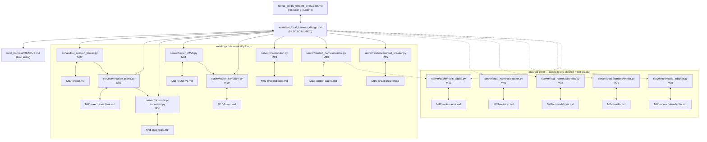

# NEXUS Docs ↔ Code Relationship Graph (loop design)

**Date:** 2026-09-14 · **Data:** `docs/nexus_docs_code_graph.json` (machine-readable, GraphRAG-ready)
**Method:** deterministic extraction (all edges EXTRACTED except `implements`, which is INFERRED-by-plan). No LLM-invented edges. **Full corpus:** `docs/**/*.md` + `designs/*.md` (125 doc nodes — includes `docs/research/`, `docs/design/`, `docs/local_harness/`).
**Stats:** 125 doc nodes · 170 code nodes · 575 edges · **32 doc↔code loops** · 15 planned files not yet on disk.
**Top doc hubs:** `designs/nexus-remediation-plan-v1.md` (38) · `integration_simulation_archify_openresearch.md` (36) · `assistant_local_harness_design.md` (31) · `docs/research/PRODUCTION_EXECUTION_PLAN.md` (25).
**Top code targets:** `.mcp.json` (23) · `server/nexus-mcp-enhanced.py` (18) · `server/learning.py` (15) · `server/router_v2/v5.py` (13).

## Mermaid — loop architecture

## The 32 loops (every loop = `doc --documents--> file`, `file --implements--> doc`)

### Adaptation loops #22–32 (new — OpenResearch + Archify targets)

| # | Doc | File | Status | Loop meaning |
|---|---|---|---|---|
| 22 | openresearch_adaptation.md | `server/local_harness/harness.py` | PLANNED | adaptation → registry impl |
| 23 | archify_adaptation.md | `docs/nexus-maps/nexus-runtime.architecture.json` | PLANNED | adaptation → runtime map |
| 24 | A01-harness-registry.md | `server/local_harness/harness.py` | PLANNED | trait spec ↔ impl |
| 25 | A03-playbook.md | `server/local_harness/playbook.py` | PLANNED | playbook spec ↔ impl |
| 26 | A06b-nexus-exp.md | `scripts/nexus_exp.py` | PLANNED | sweep-runner spec ↔ impl |
| 27 | A06c-migration-021.md | `db/migrations/021_experiments.sql` | PLANNED | exp ledger spec ↔ schema |
| 28 | A07-artifacts.md | `server/execution_plane.py` | EXISTS (extend) | manifest spec ↔ contract |
| 29 | A09-skill-packs.md | `skills/nexus-router/SKILL.md` | PLANNED | pack spec ↔ skill |
| 30 | B01-runtime-map.md | `docs/nexus-maps/nexus-runtime.architecture.json` | PLANNED | map spec ↔ IR |
| 31 | B03-flow-irs.md | `docs/nexus-maps/nexus-router-v5.workflow.json` | PLANNED | flow spec ↔ IR |
| 32 | integration_simulation_archify_openresearch.md | `docs/assistant_local_harness_design.md` | EXISTS | simulation ↔ parent design |

**How to work a loop:** open the doc (research context + pseudocode + tests) → edit/create the file → run the doc's verification → the loop closes. God-loop: research (#21) → design (#20/#32) → index → per-file builds (#1–19, #24–31) → code.

| # | Doc | File | Status | Loop meaning |
|---|---|---|---|---|
| 1 | M01-package-init.md | `server/local_harness/__init__.py` | PLANNED | package contract ↔ package |
| 2 | M02-context-types.md | `server/local_harness/context.py` | PLANNED | coeffect types ↔ impl |
| 3 | M03-session.md | `server/local_harness/session.py` | PLANNED | session lifecycle ↔ impl |
| 4 | M04-loader.md | `server/local_harness/loader.py` | PLANNED | reconcile policy ↔ impl |
| 5 | M05-mcp-tools.md | `server/nexus-mcp-enhanced.py` | EXISTS | tool registration ↔ spec |
| 6 | M06-execution-plane.md | `server/execution_plane.py` | EXISTS | contract ↔ spec |
| 7 | M07-broker.md | `server/tool_session_broker.py` | EXISTS | broker behavior ↔ spec |
| 8 | M08-opencode-adapter.md | `server/opencode_adapter.py` | PLANNED | IDE mapping ↔ impl |
| 9 | M09-preconditions.md | `server/precondition.py` | EXISTS | gates ↔ reactive spec |
| 10 | M10-fusion.md | `server/router_v2/fusion.py` | EXISTS | weights ↔ tuning spec |
| 11 | M11-router-v5.md | `server/router_v2/v5.py` | EXISTS | pipeline ↔ upgrade spec |
| 12 | M12-redis-cache.md | `server/cache/redis_cache.py` | PLANNED | L4 cache ↔ spec |
| 13 | M13-context-cache.md | `server/context_harness/cache.py` | EXISTS | L0-L3 ↔ L4-hook spec |
| 14 | M14-rate-proxy.md | `server/integrations/rate_limited_proxy.py` | EXISTS | quota store ↔ docs note |
| 15 | M15-circuit-breaker.md | `server/resilience/circuit_breaker.py` | EXISTS | breaker ↔ realm spec |
| 16 | M16-mcp-config.md | `.mcp.json` | EXISTS | spawn env ↔ pin spec |
| 17 | M17-opencode-shell.md | `opencode-with-nexus.sh` | EXISTS | launcher ↔ identity spec |
| 18 | M18-migration.md | `db/migrations/020_local_harness.sql` | PLANNED | ledger schema ↔ spec |
| 19 | M19-tests.md | `tests/test_local_harness.py` | PLANNED | acceptance ↔ suite |
| 20 | README.md | `docs/assistant_local_harness_design.md` | EXISTS | index ↔ parent design |
| 21 | assistant_local_harness_design.md | `docs/nexus_cordis_tencent_evaluation.md` | EXISTS | design ↔ research grounding |

### Base loops #1–21

## Hubs (degree = influence, full corpus)

**Top doc out-degree:** `designs/nexus-remediation-plan-v1.md` (38) · `integration_simulation_archify_openresearch.md` (36) · `assistant_local_harness_design.md` (31) · `docs/research/PRODUCTION_EXECUTION_PLAN.md` (25) · `nexus_docs_code_graph.md` (23) · `nexus_cordis_tencent_evaluation.md` (22).
**Top code in-degree:** `.mcp.json` (23) · `server/nexus-mcp-enhanced.py` (18) · `server/learning.py` (15) · `server/router_v2/v5.py` (13) · `server/db.py` / `fusion.py` / `core/learner.py` / `precondition.py` (9).
**Integration hubs (code out-degree via imports):** `server/nexus-mcp-enhanced.py` (17) · `server/tool_session_broker.py` (12) — widest ripple; HIGH-row `impact()` mandatory.
**Import cycles: 0** — new `server/local_harness/*` imports stay inward-only (harness→broker, never broker→harness at top level).

## Loop-closure checklist (ties graph to execution order)

- [ ] Phase 0 loops #1–4, #12, #18–19 + #24–27 (pure-new; closest loops, no existing-code risk)
- [ ] Phase 1 loops #5–8, #16–17, #20 + #28–29 (IDE wiring + artifacts + skill packs)
- [ ] Phase 2 loops #9–11 (HIGH risk; re-run `impact()` — `.mcp.json`×23 / `nexus-mcp-enhanced.py`×18 fan-in)
- [ ] Phase 3 loops #13–15 (+#14 docs-only) + #30–31 (maps; Archify validate→deliver→freeze)
- [ ] Each closure: update `docs/nexus_docs_code_graph.json` edge confidence `INFERRED→EXTRACTED` once the file exists and its doc verification passes.

## Files
- `docs/nexus_docs_code_graph.json` — 125 docs / 170 code / 575 edges / 32 loops (source of truth)
- `docs/local_harness/README.md` — per-file build index: M01–M19 + A01/A03/A06b/A06c/A07/A09/B01/B03 (loop entry points)
- `docs/assistant_local_harness_design.md` — HLD/LLD parent
- `docs/nexus_cordis_tencent_evaluation.md` — research root
- `docs/openresearch_adaptation.md` · `docs/archify_adaptation.md` · `docs/integration_simulation_archify_openresearch.md` — adaptation layer
