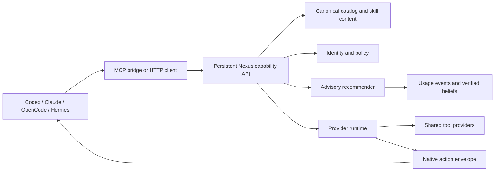

# Nexus shared capability service — execution plan

Status: Proposed, design only. Date: 2026-11-12.
The user requested detailed algorithmic instructions for every file. This directory supplies a complete proposed design using the conversation as the requirements source; architecture choices below are proposals for review, not approved production configuration. No source implementation or live configuration is changed by these documents.

## Goal and boundary

Configure shared skills and tool providers once in Nexus and serve them to Codex, Claude Code, OpenCode and Hermes. All permitted capabilities remain discoverable, including those absent from a task's recommendation slate. A skill is instruction content; a tool is an executable provider method; a native action is executed by its owning harness through a correlated adapter.

Nexus owns canonical identity, provider lifecycle, policy, discovery, recommendation and observed usage. Harnesses own reasoning, planning and native execution. Each harness needs one Nexus connection and identity; its native built-ins remain host features. Distinct users/credentials are not made interchangeable by centralization.

## Grounded starting points

- Existing task_start caps returned specialized items at eight and instructs agents to use only visible_tools. This plan changes that meaning to advisory recommendations.
- server/ephemeral_mcp_proxy.py filters an ephemeral surface; catalog access must remain available at baseline.
- /find_skills in the daemon bypasses route_for_task. /nexus/search returns query/results; blindly replacing it breaks its contract and adds session writes.
- The assigned A/B receipt has 15% top-one agreement against its own 95% target. The 2026-11-10 golden receipt has 33/105 passes; a 0.600 seed baseline used only five cases. These are historical measurements.
- Existing server/local_harness/context.py and session.py already implement effects, dependency hints and dispose. Extend these mechanisms; do not create an unrelated second context framework.
- Existing /mcp/{tool_name} HTTP proxy dynamically imports the MCP module. New MCP-to-HTTP forwarding must avoid a recursion loop here.
- Migration 023 was unused at design inspection; recheck before implementation. Existing working-tree changes belong to the user and must be preserved.

## Proposed architecture

One persistent daemon owns shared provider generations. Per-harness stdio bridges forward new shared-capability calls; they do not instantiate duplicate tool providers. Catalog recommendation is not authorization. Cleanup reverses owned registrations and handles, not irreversible external effects.

## Algorithm choices

1. Normalize canonical IDs by publisher and logical key; keep content versions, aliases and provenance separately.
2. Publish catalog revisions atomically and paginate without a fixed eight-item universe restriction.
3. Mask recommendations by visibility, permissions, compatibility and dependency readiness.
4. Combine task relevance with a niche-conditioned smoothed quality estimate. Mix a small uniform exploration component into a softmax distribution over all eligible IDs.
5. Sample recommendation slates without replacement and log conditional selection probabilities. These probabilities describe selection, not calibrated task success.
6. Invoke any permitted capability by canonical ID even when it was not recommended.
7. Pin provider generation and capability version for each invocation, enforce idempotency and track unknown write outcomes.
8. Update beliefs once from trusted per-invocation evidence. Session verdicts and simple usage counts do not become quality rewards.

## Delivery sequence and dependency gates

- Phase 0: preserve worktree, inventory provider config and canonical roots; capture copied DB/catalog/golden snapshots; run symbol impact analysis before source edits. Record every legacy routing caller as ranking, classification, diagnostic or fallback.
- Phase 1: plans 01–03 and 08; pass 17. Catalog-only shadow serving; no provider execution or harness config removal.
- Phase 2: plans 05–07; pass 19 and reward portions of 18. Use fake providers first, then one explicitly configured read-only provider.
- Phase 3: plan 04; pass recommendation portions of 18. Recommendation runs in shadow; existing ranking remains available as a diagnostic comparator.
- Phase 4: plans 09–14; pass 20 and existing regressions. Enable one harness profile at a time with reversible versioned configuration.
- Phase 5: plan 15, then run 16 on current canonical labels. Only after required gates pass migrate additional harnesses.
- Rollback: disable new compatibility forwarding using a versioned shared-capability mode (legacy / shadow / serve); drain generations, preserve all event/version tables, restore saved client configuration. Never retry unknown writes as part of rollback.

The implementation must introduce shared-capability mode through the existing central configuration accessor, not ad hoc environment reads. The supplemental configuration plan covers that change.

## Required release evidence

Catalog coverage 100% of explicitly configured canonical sources; every unsupported item explained; no hidden top-k restriction; no duplicate provider ownership; no cross-session authorization leakage; no duplicate side effects under retry; current relevance and latency gates in plan 16; every claimed harness profile tested. A failed gate blocks that rollout phase, not an invitation to lower the threshold silently.

Each receipt includes commit/worktree fingerprint, database snapshot hash, source manifest hash, canonical label mapping, catalog revision, policy version, seeds, host and timestamps. Historical receipts are never represented as fresh measurements.

## Proposed choices and alternatives

Use existing Python/SQLite Nexus and its context lifecycle for the first implementation. Directly embedding JavaScript Cordis would add a runtime and interop boundary; that option remains viable if lifecycle requirements exceed existing Python facilities. Installing every provider separately in every harness retains the duplication the user wants removed. Injecting every skill body into every prompt wastes context; paginated discovery plus on-demand full skill reads preserves access.

The initial niche-conditioned Beta smoothing is a transparent baseline, not the linear Thompson-sampling algorithm in the paper. A later contextual bandit must beat this baseline on held-out outcomes and must not learn from unverified self-reported rewards. Do not use inverse propensity estimates on deterministic legacy logs or apply single-action estimates to an entire slate.

## Source foundation

- [Cordis composability paper](https://arxiv.org/abs/2608.25512): effect cleanup and reactive dependencies.
- [MCP SDK skill support](https://ts.sdk.modelcontextprotocol.io/v2/servers/skills): shared skill discovery/read.
- [MCP notifications](https://ts.sdk.modelcontextprotocol.io/v2/servers/notifications): negotiated catalog updates; verify actual host support.
- [Contextual Thompson sampling](https://arxiv.org/abs/1209.3352): future contextual exploration research; no claim that the v1 heuristic inherits its guarantees.

## File plans

- [01-schema](./01-schema.md) — Create `db/migrations/023_capability_service.sql`
- [02-catalog](./02-catalog.md) — Create `server/capability_catalog.py`
- [03-policy](./03-policy.md) — Create `server/capability_policy.py`
- [04-recommendation](./04-recommendation.md) — Create `server/capability_recommender.py`
- [05-events-learning](./05-events-learning.md) — Create `server/capability_events.py`
- [06-runtime](./06-runtime.md) — Create `server/capability_runtime.py`
- [07-adapters](./07-adapters.md) — Create `server/capability_adapters.py`
- [08-provider-manifest](./08-provider-manifest.md) — Create `config/capability_providers.yaml`
- [09-http-api](./09-http-api.md) — Create `server/capability_api.py`
- [10-daemon-integration](./10-daemon-integration.md) — Modify `server/nexus_http_daemon.py`
- [11-mcp-integration](./11-mcp-integration.md) — Modify `server/nexus-mcp-enhanced.py`
- [12-session-broker](./12-session-broker.md) — Modify `server/tool_session_broker.py`
- [13-tool-surface](./13-tool-surface.md) — Modify `server/ephemeral_mcp_proxy.py`
- [14-unified-compatibility](./14-unified-compatibility.md) — Modify `server/unified.py`
- [15-router-skill](./15-router-skill.md) — Modify `skills/nexus-router/SKILL.md`
- [16-evaluation](./16-evaluation.md) — Create `scripts/eval_capability_service.py`
- [17-test-catalog](./17-test-catalog.md) — Create `tests/test_capability_catalog.py`
- [18-test-learning](./18-test-learning.md) — Create `tests/test_capability_learning.py`
- [19-test-runtime](./19-test-runtime.md) — Create `tests/test_capability_runtime.py`
- [20-test-contracts](./20-test-contracts.md) — Create `tests/test_capability_contracts.py`

- [21-central-config](./21-central-config.md) — Modify `core/config.py`
- [22-migration-runner](./22-migration-runner.md) — Create `scripts/migrate_capability_service.py`
- [23-router-cutover](./23-router-cutover.md) — Modify `server/router_cutover.py`; authoritative legacy compatibility adapter, required before plans 10–14.

## Document verification

All fenced `text` blocks are algorithmic pseudocode, not executable Python or shell. No production command snippets are asserted tested. Implementation acceptance scenarios are future required checks; the only prior routing unit result was 8/8 for the existing cutover tests. This design has not received a fresh Goldfish review against the changed shared-service objective.

