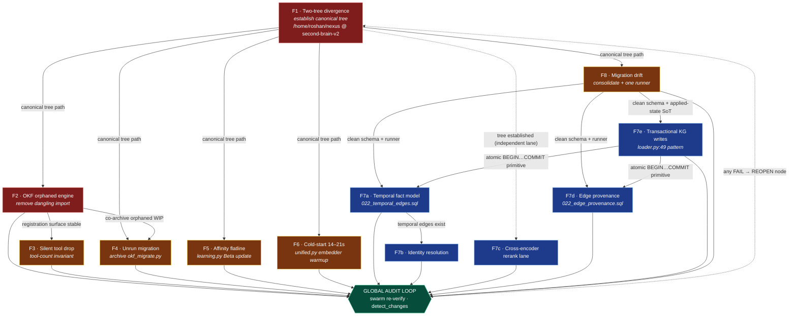
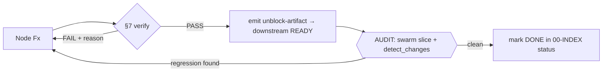

# MASTER PLAN — NEXUS Remediation Execution Graph

> A single self-aware execution graph over `F1`–`F8`. Every **node** (issue) declares its own
> preconditions, trigger, files, produced artifact, verification gate, and what it unblocks. Every
> **edge** declares the artifact it carries and the gate crossed. Execution is a topologically-ordered
> DAG with per-node verification **loops** and one global audit loop. Read this with `00-INDEX.md`.

---

## 0. The self-aware contract

Each node is a small state machine. It does **not** advance until its **entry gate** (preconditions)
is satisfied, and it does **not** unblock downstream nodes until its **exit gate** (verification)
passes. A failed exit gate loops the node back to `IN_PROGRESS` rather than leaking forward.

```
        entry gate (preconditions met)              exit gate (§7 verify PASS)
PENDING ───────────────────────────► READY ──► IN_PROGRESS ──► VERIFYING ──┬──► DONE ──► emits unblock-artifact
   ▲                                                                        │
   └──────────────────── REOPEN (verify FAIL — carry failure reason) ◄──────┘
```

An edge only "fires" (unblocks its target) when the source node reaches **DONE** and hands its
**carried artifact** across. A node with multiple inbound edges is `READY` only when *all* inbound
artifacts have arrived (AND-join).

---

## 1. Master dependency graph



---

## 2. Node registry (self-aware nodes)

Each row is the node's complete contract. `Produces` is the artifact carried on its outbound edges.

| Node | Entry gate (precondition) | Trigger | Primary files touched | Produces (unblock-artifact) | Exit gate (verify) | Unblocks |
|------|---------------------------|---------|-----------------------|-----------------------------|--------------------|----------|
| **F1** | none (root) | audit accepted | *(git/tree ops)* canonical `/home/roshan/nexus @ second-brain-v2`; archive `Downloads/nexus` | **CANONICAL_TREE_PATH** + prod entrypoint pinned | one tree builds + runs 99-tool MCP; stale tree archived | F2, F4, F5, F6, F8, (F7c) |
| **F2** | CANONICAL_TREE_PATH | F1 DONE | remove dangling OKF-engine import; keep `server/okf_sections.py`, `server/ingest/…`, `server/export/…` | **REGISTRATION_SURFACE_STABLE** | enhanced server imports clean; 99 tools register | F3, F4 |
| **F3** | REGISTRATION_SURFACE_STABLE | F2 DONE | `server/nexus-mcp-enhanced.py` (count invariant); `server/harness_mcp_bridge.py:~316` (`except Exception`) | **TOOL_COUNT_INVARIANT** | boot asserts ≥ `EXPECTED_MIN`; structured shortfall log | AUDIT |
| **F4** | CANONICAL_TREE_PATH ∧ F2 | F1+F2 DONE | archive `Downloads/nexus/theater_backup/okf_migrate.py` | **WIP_ARCHIVED** | file gone from live tree; no import references | AUDIT |
| **F5** | CANONICAL_TREE_PATH | F1 DONE | `server/learning.py:1139-1156, 1166-1206, 1209-1239`; `server/cluster_router.py` | **AFFINITY_DIFFERENTIATES** | synthetic stream → spread > 0.2, none pinned 1.0 | AUDIT |
| **F6** | CANONICAL_TREE_PATH | F1 DONE | `server/unified.py:50, 1140-1153`; `IsoEmbedder` singleton | **WARM_EMBEDDER** | cold-start p50 < 3s after warmup task | AUDIT |
| **F8** | CANONICAL_TREE_PATH | F1 DONE | consolidate `migrations/`+`db/migrations/`; `007_graph_topology.sql`; `schema_migrations`; retire `run_migration_00N.py` → one runner | **CLEAN_SCHEMA + APPLIED_STATE_SoT** | fresh DB byte-matches live baseline; runner idempotent (0 pending) | F7e, F7a, F7d |
| **F7e** | CLEAN_SCHEMA | F8 DONE | `server/local_harness/loader.py:49` (pattern); KG writers (`learning.py`, `kg_service.py`, `densify_kg.py`) | **ATOMIC_WRITE_PRIMITIVE** | injected mid-batch failure → full ROLLBACK (row counts/checksums unchanged) | F7a, F7d |
| **F7a** | CLEAN_SCHEMA ∧ ATOMIC_WRITE_PRIMITIVE | F8+F7e DONE | new `022_temporal_edges.sql` + ALTER live; `server/router_v2/fusion.py` (recency) | **TEMPORAL_EDGES** | as-of query returns point-in-time correct edge set | F7b, AUDIT |
| **F7d** | CLEAN_SCHEMA ∧ ATOMIC_WRITE_PRIMITIVE | F8+F7e DONE | new `022_edge_provenance.sql` + ALTER live | **PROVENANCE_COLUMNS** | every new edge carries `source_ref/activity/agent` | AUDIT |
| **F7b** | TEMPORAL_EDGES | F7a DONE | entity-resolution lane (identity keys) | **CANONICAL_IDS** | duplicate entities merge; edges rebind to canonical id | AUDIT |
| **F7c** | CANONICAL_TREE_PATH | F1 DONE (independent) | cross-encoder rerank lane in retrieval | **RERANK_LANE** | rerank improves top-k over BM25/vector baseline | AUDIT |

---

## 3. Edge registry (typed edges)

| # | From → To | Type | Carried artifact | Gate crossed |
|---|-----------|------|------------------|--------------|
| e1 | F1 → F2 | BLOCKS | CANONICAL_TREE_PATH | tree established |
| e2 | F1 → F4 | BLOCKS | CANONICAL_TREE_PATH | tree established |
| e3 | F1 → F5 | BLOCKS | CANONICAL_TREE_PATH | tree established |
| e4 | F1 → F6 | BLOCKS | CANONICAL_TREE_PATH | tree established |
| e5 | F1 → F8 | BLOCKS | CANONICAL_TREE_PATH | tree established |
| e6 | F1 ⇢ F7c | ENABLES (soft) | tree established | independent lane may start |
| e7 | F2 → F3 | BLOCKS | REGISTRATION_SURFACE_STABLE | clean import surface |
| e8 | F2 → F4 | INFORMS | co-archive decision | shared removal |
| e9 | F8 → F7e | BLOCKS | CLEAN_SCHEMA + APPLIED_STATE_SoT | schema trustworthy |
| e10 | F8 → F7a | BLOCKS | CLEAN_SCHEMA + runner | migratable surface |
| e11 | F8 → F7d | BLOCKS | CLEAN_SCHEMA + runner | migratable surface |
| e12 | F7e → F7a | BLOCKS | ATOMIC_WRITE_PRIMITIVE | atomic batch available |
| e13 | F7e → F7d | BLOCKS | ATOMIC_WRITE_PRIMITIVE | atomic batch available |
| e14 | F7a → F7b | BLOCKS | TEMPORAL_EDGES | temporal edges exist |
| e15 | * → AUDIT | VERIFY | node exit-artifact | swarm re-verify |
| e16 | AUDIT ⇢ * | REOPEN (loop) | failure reason | any FAIL reopens node |

---

## 4. Execution sequence — topological waves

Nodes in the same wave have no edges between them and run **in parallel**.

| Wave | Nodes | Rationale | Parallelism |
|------|-------|-----------|-------------|
| **W0** | `F1` | Systemic root; nothing is trustworthy until the canonical tree is fixed | 1 |
| **W1** | `F2` · `F5` · `F6` · `F8` | All depend only on CANONICAL_TREE_PATH; disjoint files | 4-way |
| **W2** | `F3` · `F4` · `F7c` | F3 after F2; F4 after F2; F7c independent lane | 3-way |
| **W3** | `F7e` | Needs CLEAN_SCHEMA (F8); provides the atomic primitive | 1 |
| **W4** | `F7a` · `F7d` | Both need F8 + F7e; disjoint migrations (`022_temporal` vs `022_provenance`) | 2-way |
| **W5** | `F7b` | Needs TEMPORAL_EDGES (F7a) | 1 |
| **Wᴬ** | `AUDIT` | Runs after every wave; on FAIL, reopens the offending node and its downstream | loop |

Critical path (longest chain): **F1 → F8 → F7e → F7a → F7b** (5 hops). Everything else folds into
its slack. F5, F6, F3, F4, F7c, F7d are off the critical path and should be scheduled to fill it.

---

## 5. Feedback loops (self-correction)

Two loop classes keep the graph honest:

**(a) Per-node verify loop** — `IN_PROGRESS → VERIFYING → {DONE | REOPEN}`. The exit gate is the
doc's §7 pass/fail test. FAIL carries a *failure reason* back into the node; it never crosses the edge.

**(b) Global audit loop** (`AUDIT` node) — after each wave, re-run the relevant slice of the original
5-agent swarm + `detect_changes()` to confirm no node's change regressed a sibling. Because F7a/F7d
mutate the same `resource_edges` table, the audit specifically re-checks that F7a's temporal columns
and F7d's provenance columns coexist under the F8 baseline (the "coexist" invariant from `F8 §7`).



---

## 6. File → trigger map (which edit fires which check)

When a file is edited, the listed verification and RCA marker are triggered automatically.

| File (edit site) | Node | Fires verification | RCA marker |
|------------------|------|--------------------|------------|
| *(git tree / entrypoint)* | F1 | build + 99-tool MCP smoke | canonical-tree note |
| dangling OKF import removal | F2 | `import server.nexus_mcp_enhanced` clean | `RCA-F2` |
| `server/nexus-mcp-enhanced.py` startup | F3 | tool-count ≥ `EXPECTED_MIN` assert | `RCA-F3` |
| `server/harness_mcp_bridge.py:~316` | F3 | structured `tool_registration` event emitted | `RCA-F3` |
| `Downloads/…/okf_migrate.py` | F4 | no live import references remain | *(removal — unmarked)* |
| `server/learning.py:1139-1156` | F5 | saturation test → differentiation > 0.2 | `RCA-F5` |
| `server/learning.py:1209-1239` | F5 | live read-path equivalence test | `RCA-F5` |
| `server/unified.py:50` + `:1140-1153` | F6 | cold-start p50 < 3s | `RCA-F6` |
| `migrations/*`+`db/migrations/*`, runner | F8 | fresh-DB == baseline; runner idempotent | `RCA-F8` |
| `db/migrations/007_graph_topology.sql` | F8 | live DDL reconciled | `RCA-F8` |
| `server/local_harness/loader.py:49` (ref) | F7e | mid-batch fail → full ROLLBACK | `RCA-F7e` |
| new `022_temporal_edges.sql` | F7a | as-of point-in-time query correct | `RCA-F7a` |
| `server/router_v2/fusion.py` | F7a | recency weight affects ranking | `RCA-F7a` |
| new `022_edge_provenance.sql` | F7d | new edges carry provenance triple | `RCA-F7d` |

---

## 7. Scheduling rule (how an executor uses this graph)

1. Compute the frontier = all nodes whose inbound artifacts have **all** arrived (AND-join, §2).
2. Execute the frontier in parallel; each node runs its §6 file edits + adds its `RCA-` marker.
3. Run each node's §7 verify (exit gate). PASS → emit artifact; FAIL → REOPEN with reason.
4. After the wave, run `AUDIT` (§5b). On regression, REOPEN the offending node.
5. Update the node's status in `00-INDEX.md` (OPEN → DONE).
6. Recompute the frontier; repeat until all nodes DONE and `AUDIT` is clean.

Invariant: **no node edits a file before its entry gate is green, and no edge fires before its exit
gate is green.** That is what makes the flow self-aware — the graph, not the operator, decides what
is allowed to run next.
